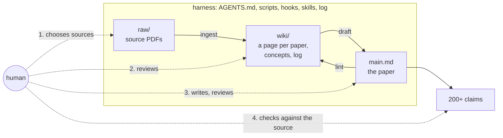

# Avoimet tehtävät: postaukset

Paperi on julkaistu: https://doi.org/10.5281/zenodo.24459573

## Postaukset (kotisivun blogi kattava ensin, LinkedIn lyhyt sen jälkeen)
Sisältö ja ideat `docs\private\llm-wiki-post`. Luonnostelu rinnakkain, blogipostaus julkaistaan ensin koska LinkedIn teskti tarvitsee linkin. Luvut pyöristetään ("yli 200 väitettä", "yli 30 lähdettä", "lähes 40 omaa päätelmää"), kun tarkka arvo ei ole oleellinen.
- [ ] Blogipostaus ensin `2026-11-23-llm-wiki-and-academic-review.md`: katso kohdat kuntoon [blogi-tehtävälistaus](#julkaisu-kotisivulle)

- [ ] Kun blogi on julkaistu:
  - [ ] lisää sen linkki MEA_review_llm_wiki-repon README:hen (templaatin linkki on jo siellä)
  - [ ] tarkista blogin osoite MEA_review_llm_wiki-repon `docs/private/mainosviestit.md`:ssä, täytä LinkedIn-viestien `<name>`/`<nimi>` ja lähetä viestit (Slack, WhatsApp, LinkedIn)
  - [ ] poista `_notes/llm-wiki-post/` tai merkitse valmiiksi ("Siirto julkaisuun", askel 7)

- [ ] LinkedIn-postaus blogin jälkeen `linkedin_draft.md`: viittaa repoon, Zenodoon ja blogiin
  - [ ] valitse versio (suositus E) ja avaus A tai B; B:n kanssa toinen kappale kirjoitetaan uudelleen (vaihtoehdot `linkedin_draft.md`:ssä, "Vaihtoehtoja versioon E")
  - [ ] mahdolliset bulletinvaihdot: "Summaries drift" ja/tai pääviestin bulletti
  - [ ] kuva: `linkedin_draft.md` suosittelee virheen leviämisen kaaviota, mutta 23.11. valittiin työnkulun kaavio (ks. "Työnkulun kaavio" alla). Jos piirrät vain yhden, työnkulun kaavio, koska se käy myös blogiin
  - [ ] PaperOrchestra-rivi: pidä vai pudota; jos julkaisu viivästyy, poista sana "new"
  - [ ] tarkista, että `/grinding` skills mainittu, ja karsi hashtagit
  - [ ] korvaa `<BLOG-LINKKI>` (5 kohtaa)

## Julkaisu kotisivulle
- [ ] **pääviesti: wikin ylläpito on se osa, joka unohtuu.** Karpathyn gistin kohdat kuten "*The synthesis already reflects everything you've read*" ja "*I browse the results in real time — following links, checking the graph view, reading the updated pages*" 
- [ ] tarkista blogin kaikki `[CLAUDE]`-merkityt kohdat (20 kpl 23.11.; `[CLAUDE 22.11.]`, `[CLAUDE 23.11.]` ja päiväämättömät) ja poista merkinnät. Erityisesti "The part that is easy to skip" (ettei toistu lopun vinkeissä), koko "What I would do differently" ja Practical tips -listan `[CLAUDE]`-kohdat
- [ ] postaus on noin 7 200 sanaa (kommentteineen); lyhennysehdokkaat "Co-writing without git skills" (kokeilematon idea) ja "Where the paper is published"
- [ ] päätä valinnaiset TODOt: Claude Code vs. Gemini notebook -kappale ("Finding sources" -osion lopussa) ja konkreettinen esimerkki paperi → wikisivu → viite ("The workflow in practice")
- [ ] kirjoita TODO "Why an LLM wiki?": 1–2 lausetta, miksi wiki eikä pelkkä chat tai viitteidenhallinta
- [ ] tarkista käännös (TODO "Giving a new chat a well-scoped task" -osiossa)
- [ ] kuvat, ks. "Kuvat" alla: työnkulun kaavio Excalidraw'ssa (korvaa The method -osion TODOn), after-kuva graafinäkymästä, päätös virheen leviämisen kaaviosta ja muistikuvasta
- [ ] julkaisu: kts "Siirto julkaisuun" alla

### Työn aikana

- Kirjoita postausta suoraan luonnostiedostoon `2026-11-23-llm-wiki-and-academic-review.md`.
- **Kuvat ovat kansiossa `_notes/pics/posts/`, joka peilaa kansiota `pics/posts/`.** Tämä tiedosto on tasolla `_notes/llm-wiki-post/`, joten kuviin viitataan muodossa ``. Sama viittaus toimii sellaisenaan julkaisun jälkeen: `_posts/<postaus>.md` viittaa tiedostopuussa kansioon `pics/posts/`, ja sivun osoitteesta `/blog/<otsikko>.html` katsottuna `../` osuu sivuston juureen eli osoitteeseen `/pics/posts/<nimi>.png`.
- **Älä muuta tämän tiedoston kansiotasoa** (`_notes/<kansio>/<tiedosto>.md`), koska `../`-viittaukset perustuvat siihen.
- Kuvan liittäminen leikepöydältä: asetus `markdown.copyFiles.destination` on `.vscode/settings.json`:ssa, ja se kopioi liitetyt kuvat kansioon `_notes/pics/posts/` ja kirjoittaa linkin automaattisesti. **Tiedosto on gitignoressa**, joten se on vain tällä koneella. Uudessa kloonissa asetus pitää luoda uudestaan (kopioi se tästä): `"markdown.copyFiles.destination": {"/_notes/**/*": "${documentWorkspaceFolder}/_notes/pics/posts/${fileName}"}`.
- Jos linkistä puuttuu `!`, se renderöityy linkkinä eikä kuvana. Korjaa käsin muotoon ``.
- Käytä kuvien nimissä yhteistä alkua (esim. `llm-wiki_…`), jotta nimet eivät törmää kansion `pics/posts/` nykyisiin kuviin siirrossa.

### Siirto julkaisuun

1. Tarkista, että kaikki `- [ ] TODO`- ja `[CLAUDE]`-kohdat on käsitelty, ja poista luonnoksen alun HTML-kommentti.
2. Lisää kuvalinkkeihin `!`, eli `[kuvaus](../pics/posts/…)` → ``. Figcaptionit ovat jo valmiina.
3. Päivitä front matterin `date` ja tiedostonimen päivämäärä julkaisupäiväksi, jos se ei ole 2026-11-23 (molemmat ovat nyt 2026-11-23). Front matter ja include ovat jo luonnoksessa (malli: `_posts/2025-03-23-my-struggle-to-make-post-work-properly.md`).
4. Siirrä kuvat kansiosta `_notes/pics/posts/` kansioon `pics/posts/`. Siirrä vain ne, joita postaus käyttää, ja tarkista, ettei samannimistä kuvaa ole jo olemassa. Linkkejä ei tarvitse muuttaa.
5. Siirrä luonnos: `git mv _notes/llm-wiki-post/2026-11-23-llm-wiki-and-academic-review.md _posts/`.
6. Aja Jekyll paikallisesti tai tarkista GitHub Pagesin build push:n jälkeen. Tarkista erityisesti, että kuvat näkyvät postauksen sivulla (`../pics/posts/…` ratkeaa osoitteessa `/blog/<otsikko>.html` kansioon `/pics/posts/`). Jos ei, vaihda polut muotoon `/pics/posts/…`, kuten aiemmissa postauksissa.
7. Poista `_notes/llm-wiki-post/` tai merkitse se valmiiksi, kun postaus on julkaistu.

### Älä tee

- Älä laita keskeneräistä tekstiä `_posts/`-kansioon: ensimmäinen push julkaisee sen.
- Älä jätä luonnostiedostoa juureen: juuren `.md`-tiedostot julkaistaan sivustolle.
- Älä liitä luonnoskuvia suoraan kansioon `pics/posts/`: ne julkaistaan sivustolle heti pushin jälkeen ja löytyvät osoitteesta `https://anahill.github.io/pics/posts/<nimi>.png`, vaikka postaus ei olisi julkaistu. Kansion `_notes/pics/posts/` kuvia Jekyll ei julkaise (alaviivalla alkavat kansiot jäävät pois), mutta ne näkyvät GitHubissa.

## Kuvat

Kaikki kansiossa `../pics/posts/` eli `_notes/pics/posts/`. Kotisivu on ainoa paikka: paperin repon `docs/private/`-kopiot poistettiin 23.11.2026. Luonnoksessa pelkkinä linkkeinä, julkaisussa lisätään `!`.

| Kuva | Missä luonnoksessa | Parannusideoita |
|---|---|---|
| `llm-wiki_graph_view_fpd-end-conventions.png` | The method | Sama kuin MEA_review_llm_wiki-repon README:ssä (`docs/images/fpd-end-conventions-graph-view.png`, 23.11.), kopioitu tänne. Asetukset: repon `docs/images/README.md`. |
| `llm-wiki_graph_view_wiki_exclude_index.png` | Knowledge has to flow back (before) | Ennen tagiremonttia: kertakäyttötagit (`#brv`, `#video`, `#impedance` …) näkyvät. Filtteripaneeli saa jäädä, se selittää indexin puuttumisen. |
| `llm-wiki_graph_view_after_tag_rework.png` | Knowledge has to flow back (after) | **Ottamatta.** Samat ehdot kuin before-kuvassa, ohje MEA_review_llm_wiki-repon `docs/images/README.md`:ssä ("Before/after pair"). |
| `llm-wiki_loop_work.png` | The wiki structure pays off | Suomenkielinen agentin raportti; figcaptionissa "(in Finnish)". |
| `llm-wiki_loop_work2.png` | The wiki structure pays off | |
| `llm-wiki_human-in-the-loop.png` | Esimerkki C | Nimetty uudelleen 23.11. (oli `…-tarkeys.png`). |
| `llm-wiki_critical_assessment.png` | What else worked | Nimetty uudelleen 23.11. (oli `…_critical_assignment.png`). |
| `llm-wiki_claude_memory.png` | What else worked | Heikko: näyttää vain lokakuun tiedostolistan, kun teksti puhuu `MEMORY.md`:n indeksirivistä. Mietitään parempi kuva (esim. `MEMORY.md`:n sisältö, jossa commit-sääntö on indeksirivillä). |
| (puuttuu) työnkulun kaavio | The method + LinkedIn | `raw/` → ingest → `wiki/` → draft → `main.md`, lint takaisin wikiin; harness kehyksenä. Ihminen mukana neljässä kohdassa: `raw/`, wiki, `main.md` ja väitteet. Mermaid-pohja alla ("Työnkulun kaavio"). |
| (puuttuu) virheen leviämisen kaavio | How a wrong claim spreads | Sama kuva kelpaa LinkedIniin (ks. linkedin_draft.md). |
| (idea) ennen/jälkeen | The workflow in practice | Yksi kappale, jossa `[CITATION NEEDED]` korvautuu viitteellä; tai yksi paperi → wikisivu → viite main.md:ssä. |

Markmap-kuva (`llm-wiki_markmap_analysis.png`) poistettu 23.11.: markmap jätettiin pois, ks. MEA_review_llm_wiki-repon `docs/images/README.md`.

### Työnkulun kaavio (blogi + LinkedIn)

Idea 23.11.: sama kuva blogin The method -osioon ja LinkedIn-postaukseen. Kuva kertoo pääviestin "kirjanpito halpaa, tarkistaminen ei": agentti hoitaa kirjanpidon (ingest, draft, lint; lint tarkistaa wikiä vain itseään vasten), mutta ihminen on mukana jokaisessa kerroksessa: valitsee lähteet `raw/`-kansioon, käy läpi ja tarkastaa wikin, kirjoittaa ja tarkastaa `main.md`:n ja tarkistaa väitteet lähdettä vasten. Ihmishahmo piirretään Excalidraw'ssa vasemmalle.

Toimii Excalidraw'n Mermaid-tuonnissa (24.11.): solmut määritellään subgraphin sisällä ennen nuolia, `<br/>` eikä `<br>`, ei `·`-merkkejä eikä lainausmerkkejä nuolten teksteissä.



- Excalidraw-pluginin Mermaid-tuonti: vain flowchart muuttuu muokattaviksi muodoiksi (muut kaaviotyypit tulevat kuvana). Värit ja tyylit vasta Excalidraw'ssa, ei `classDef`-määrittelyjä.
- LinkedIn-koko 1200×627 (vaaka) tai 1080×1080 (neliö); isot tekstit, koska moni katsoo puhelimella.
- Vaihtoehto, jota ei valittu: ennen/jälkeen-pari keksitystä lähteestä ("Galli et al. 2024"). Pysäyttää selaajan, mutta kertoo vain virheestä, ei menetelmästä; esimerkki sopii paremmin postauksen tekstiin.

## Alkuperäinen ohjeistuskehote uudelle chatille (käännöksen tarkistukseen)

Luonnoksessa on tästä englanninkielinen, lyhennetty käännös. Tarkista käännös tätä vasten.

```text
Tehtävä: kirjallisuushaku yhteen aukkoon review-paperissani. Älä muokkaa main.md:tä etkä wikiä tässä vaiheessa; raportoi löydökset ensin.

Lue ensin:
- AGENTS.md (työtapa; erityisesti "Never invent citations" ja "Batch or undirected additions — verify before ingesting")
- main.md, osio "Maturation status as an unresolved confound for MEA-derived metrics" ja Conclusionin neljäs aukko ("hiPSC-CM maturation status lacks MEA-derived reference values")
- wiki/hipsc-cm-maturation.md
- wiki/papers/fetterman-2024-maturation.md, wiki/papers/clements-2025-aims-poster.md, wiki/papers/scheurer-2025-optical-ai.md, wiki/papers/guerrelli-2024-hipscm.md, wiki/papers/hayakawa-2014-motion-fp.md
- wiki/index.md (jo käsitellyt lähteet, ettei niitä ehdoteta uudelleen)
- docs/search-strategy.md

Kysymys: onko julkaistu (vertaisarvioitu tai preprint) työtä, joka ehdottaa tai validoi MEA:lla (extracellular field potential) mitattavia viitearvoja tai luokittelijaa hiPSC-kardiomyosyyttien kypsyysasteelle (esim. FPD, spike amplitude, upstroke/depolarisaation nopeus, conduction velocity, beat rate tai näiden yhdistelmä kypsyyden merkkinä)? Myös ennen 2022 julkaistut kelpaavat, jos ne vastaavat tähän; ne merkitään paperissa taustaksi (kuten Blinova 2018 ja Hayakawa 2014).

Hae ainakin PubMedista, Google Scholarista ja bioRxivista, ja seuraa löydettyjen papereiden viitteitä ja niihin viittaavia töitä. Hakusanoja: "hiPSC-CM maturation" + "multielectrode array" / "field potential" / "MEA", "maturity marker", "maturation index", "electrophysiological maturation" + "MEA", "conduction velocity maturation hiPSC-CM".

Raportoi jokaisesta ehdokkaasta: tekijät, vuosi, otsikko, lehti, DOI (vain jos varmistettu lähteestä; muuten merkitse "unverified"), mitä MEA-parametreja se kytkee kypsyyteen, onko se validoitu jotain vertailua vastaan (esim. patch clamp, geeniekspressio, aikuisen kudos), ja arvio: kattaako se aukon, osittain vai ei. Kirjaa myös hakulausekkeet, tietokannat ja päivämäärä, jotta main.md:n "targeted search" -virke voidaan perustaa todelliseen hakuun.

Älä lisää mitään raw/-kansioon. Lähetän PDF:t itse niistä, jotka päätän ingestoida.
```
